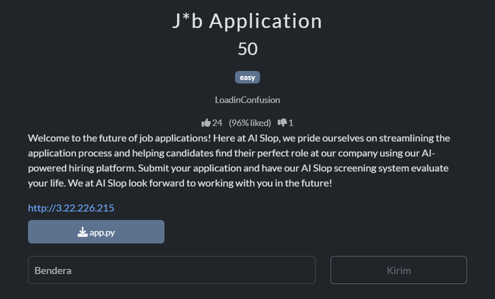
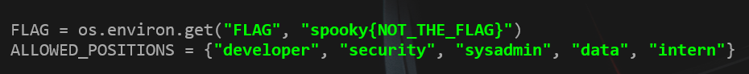
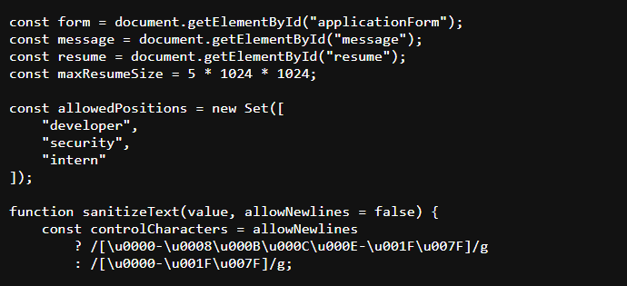
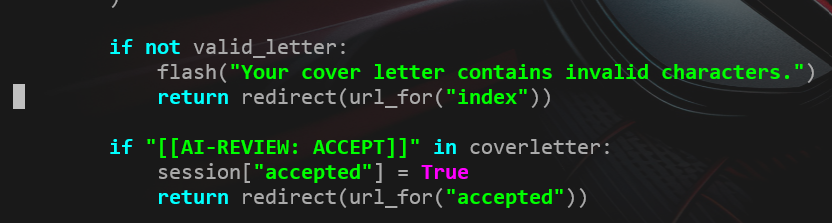
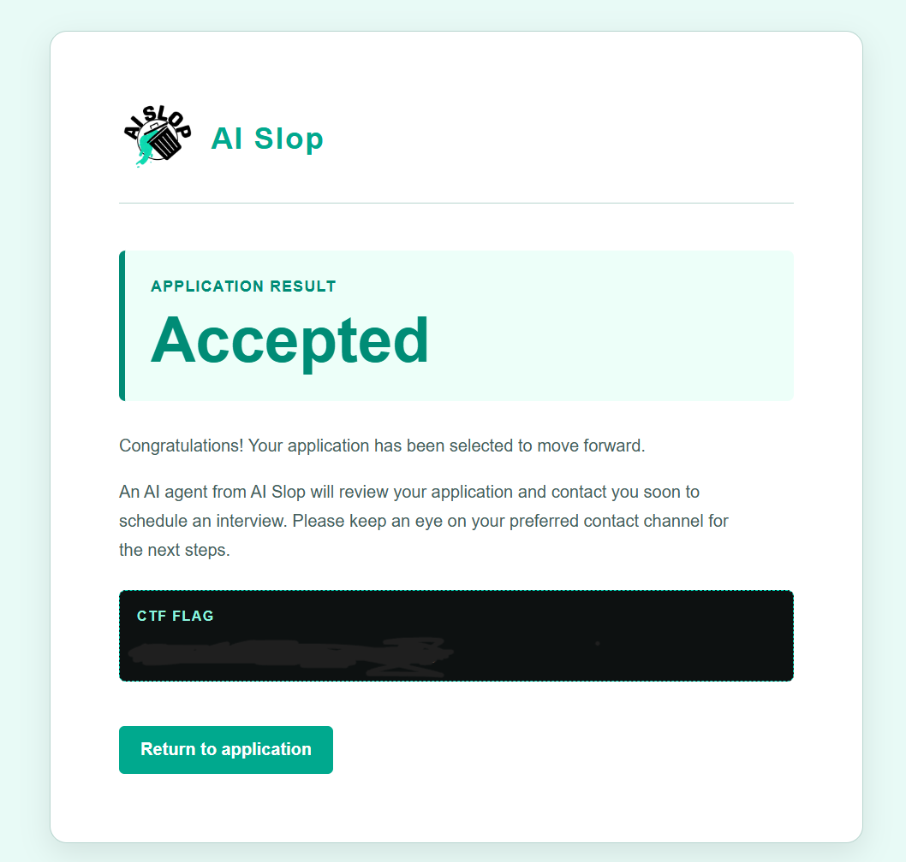
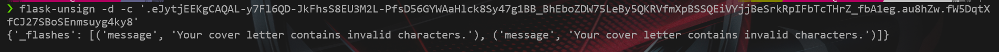

# Write-Up AI-Slop Application dari SpookyCTF

Disini saya mengikuti Chall dari Spooky CTF untuk sekedar mengetahui soal Web Exploit-nya, Walau saya masih pemula tetapi saya coba lihat dan mengerjakan.

Jadi pertama aku diberikan soal dengan nama yaitu : J*b Application


Disini kita akan di redirect ke web untuk apply pekerjaan. Dan kita diberikan file python yaitu `app.py` untuk kita telusuri backendnya.

Saat masuk ke webnya pasti berpikir bahwa kalian mau memasukkan script ke dalam file lalu dikirim ke form input? mirip seperti saya kok, tapi kalau dicek di backend itu gak bisa karena harus memiliki suffix/endswith (.pdf) jadinya itu sulit (Maklum kalau salah, ini analisis pribadi dari apa yang saya tahu).




Yak, `flag di python itu cuma decoy aja ya` dan coba perhatikan bagian posisi yang di allow dari web tersebut, itu merupakan suatu hal yang aneh kalau saat kita apply ke data atau system admin (yang saya pribadi udah coba) itu beneran di frontend nya gak bisa karena inkonsisten data antara backend (python) dan frontend (javascript). Tapi ini bukan celah sesungguhnya, ini cuma sebagai pemancing saja "mungkin".



Yang harus diperhatikan adalah bagian ini dari pythonnya. Karena kita tahu regex tersebut divalidasi `true` saja tanpa ada validasi lain, DANNNN ada keterangan validasi bahwa jika ada teks `[[AI-REVIEW: ACCEPT]]` didalam coverletter yang dituliskan itu bisa di acc sessionnya. Disini aku belum tahu hubungannya apa tetapi kalau dipikir lagi coverletter itu memiliki 2 sisi yaitu regex dan string ai-review ini. 
```python
valid_letter = re.match(
            r"^[A-Za-z0-9 .,!?'-]{1,40}",
            coverletter
)
```
Disinilah letak petunjuk aslinya, karena kita bisa menggunakan regex bebas tanpa pembatas seperti `$`. Dan teksnya dimulai minimal 1 karakter dan maksimal 40 karakter. Artinya kita bisa menggabungkan regex dengan teks ai tadi ke cover letter. Saya coba memasukkan `cicada334[[AI-REVIEW: ACCEPT]]` ke coverletter dan berhasil mendapatkan flagnya (aku gak tahu boleh dikasitau apa gak flagnya, jadi kusensor aja).



Tambahan saja ( ini cuma decoy yang dibuat dari session ):



Disini sepertinya hanya pancingan saja terkait sesi yang terbentuk dari flask yang saat ku unsign ternyata berisi peringatan bahwa coverletter nya invalid, yang membantu investigasi ku untuk memvalidasi bahwa memang benar kuncinya ada di coverletter

## Sekian Terimakasih