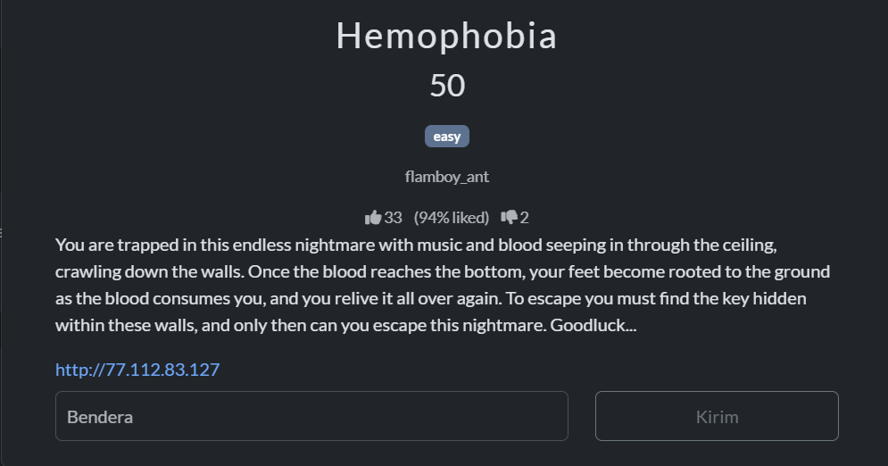
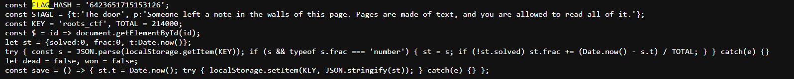
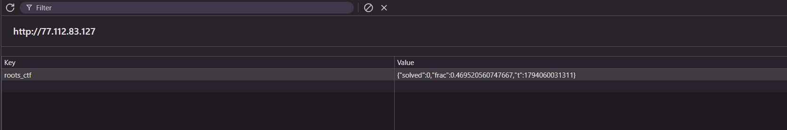
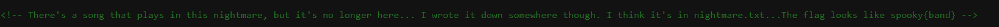
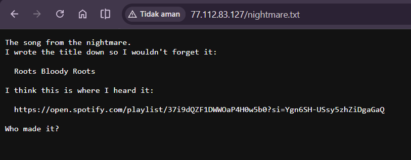
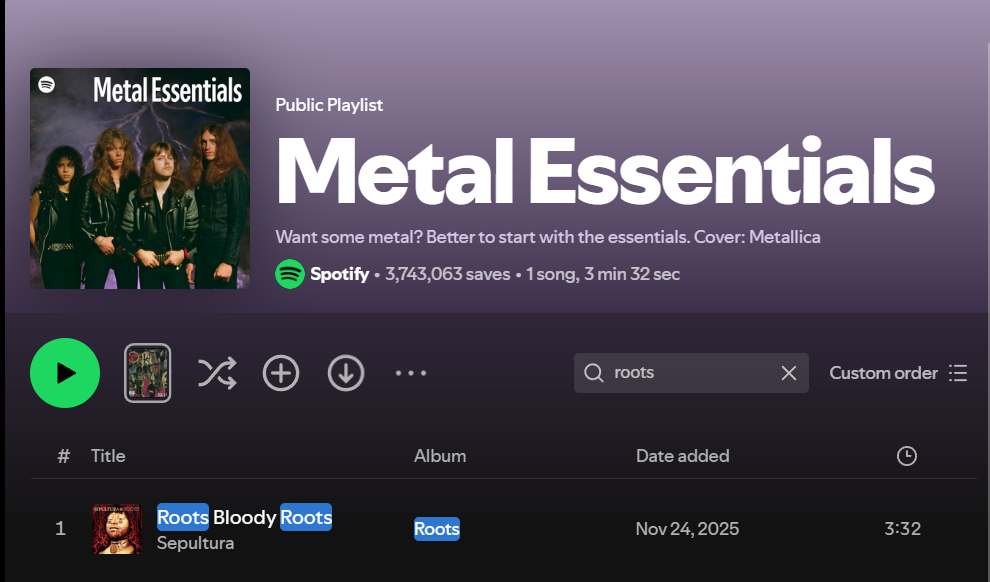

# Write-Up Hemophobia SpookyCTF

Disini kita diberikan challenge kedua dari kategori Web Exploit untuk mencari cara keluar dari web yang dihitung waktunya dan akan diulang terus kalau bloodnya sampai bawah/selesai (aku lupa gak screenshot). Jadi intinya kita disuruh untuk mencari flag dari petunjuk yang "Ditempelkan di dinding".

Deskripsi soalnya ada yang seperti ini `"Someone left a note in the walls of this page. Pages are made of text, and you are allowed to read all of it."`. Nah disinilah titik saya mencari dibagian mana catatan ini ditinggalkan (Saya mencari cari ke bagian javascript nya yang disitu ada validasi FLAG_HASH yang harus sama nilainya agar di accept)

Dan disitu terletak juga KEY yang ada valuenya yaitu `roots_ctf` dan saat kucari key nya ternyata itu ada di localstorage (di menu inspect).

Tapi kedua itu tidak memberikan apapun soal petunjuk yang sesuai dengan deskripsi dan javascriptnya pun tampak seperti melakukan validasi saja dari hashingan flag yang diinput di web blood itu. Jadi coba aku cari kebagian source html.

`"There's a song that plays in this nightmare, but it's no longer here... I wrote it down somewhere though. I think it's in nightmare.txt...The flag looks like spooky{band}.`

Dan ini merupakan petunjuk final yang membawa saya ke nightmare.txt yang ternyata saat saya coba-coba itu beneran ada di path url nya. Perlu diperhatikan juga isi dialam flagnya itu berkaitan dengan nama band dari lagu tersebut.

Disini sudah jelas petunjuknya bahwa ada judul lagu yaitu `Roots Bloody Roots` yang kemudian kita diberikan link API dari playlist lagu tersebut, dan aku coba search.

Dan disini aku coba memasukkan nama band nya (mungkin) yaitu sepultura. Disini aku sudah membaca kode javascriptnya, dia akan mengubah input kata-katanya ke lowercase, jadi gak ngaruh kalau kamu masukin uppercase gitu. Jadi aku input saja di web blood (sebelum waktu habis yaitu 3 menit dari web nya, tapi itu looping sih) yaitu spooky{sepultura}. Dan ternyata berhasil ada tanda bahwa `You got out` yang berarti aku berhasil keluar. Disini aku coba input flag yang sama ke web ctf nya dan berhasil. YESSSSSS.....

## Sekian Terimakasih
Mohon maaf apabila ada salah kata dan cara, semoga dimaklumi karena aku sendiri masih belajar