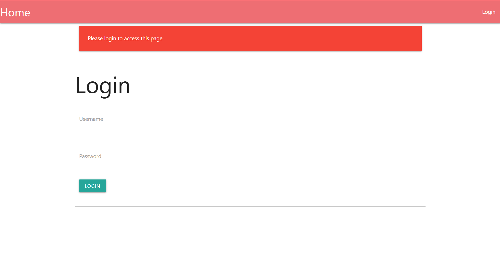
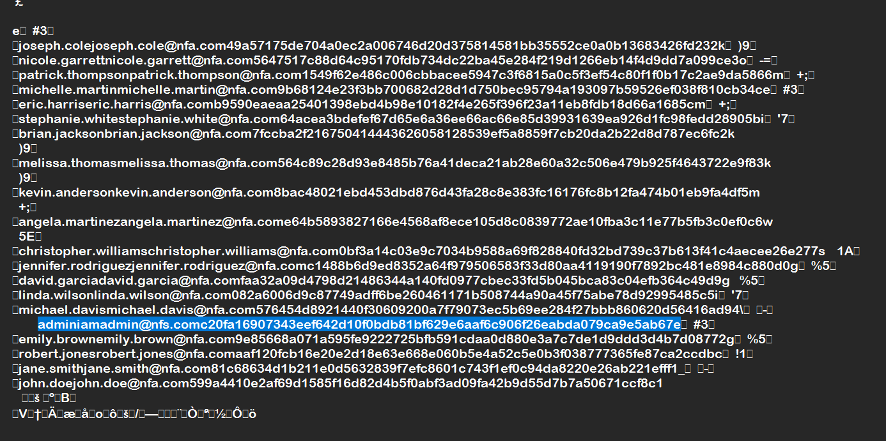
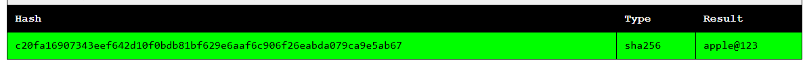

# Write-Up No FA chall dari picoCTF
`Chall No FA ini berkategori Web Exploitation dengan difficulty Medium.`

Di tahap pertama kita diberikan URL ke halaman login yang meminta Username dan Password.



Dan yang harus diperhatikan adalah file `users.db` yang diberikan. Ternyata isinya adalah data-data user yang tersimpan di database, dan data admin ada didalam situ. Disini saya membukanya di notepad, karena aku tadinya coba menggunakan DB Browser dan ternyata filenya gak bisa dibaca dengan itu.



Nah disini saat dilihat aku gak tahu ini jenis algoritma enkripsi/hashing apa, dan setelah aku membaca kode pythonnya yaitu `app.py` disitu aku tahu bahwa yang divalidasi adalah SHA256. Aku disini menggunakan Crackstation untuk meng-crack hashingan ini untuk mendapatkan passwordnya. `c20fa16907343eef642d10f0bdb81bf629e6aaf6c906f26eabda079ca9e5ab67` ini merupakan hashing yang harus dicari, aku sudah mencoba dari c sampai e itu gagal dan kucoba coba dari 2 sampai e juga gagal, dan akhirnya ketemulah c sampai 7. Dan hasilnya adalah `apple@123` untuk passwordnya.



Kemudian, kalian bisa coba akses ke halaman login tadi dengan username itu `admin` dan password itu `apple@123`. Nah setelah login tersebut, kita akan dimintain kode OTP, tapikan disini kita gak ada akses ke email dari admin tersebut ( terlalu jauh kalau kita sampai menyusup ke emailnya ), jadi kita bisa coba lihat ke Inspect/DevTools, Lalu kebagian application dan cek ke Cookie dan lihat name serta value nya. Disitu kita dapat name = `session` dan value = [Value cookie-mu]. Lalu copy saja value nya dan gunakan flask unsign untuk men-decode cookie nya.
```bash
flask-unsign -d -c 'Value_cookie'
```
Nah setelah itu kita akan dapat OTP Secret yang tadi digunakan untuk menyimpan OTP yang digenerate melalui python.

`{logged': 'false', 'otp_secret': '7621', 'otp_timestamp': 1793691684.1870017, '
username': 'admin'}`

Seperti ini contohnya.

Kemudian kalian bisa masukkan OTP tersebut ke halaman web yang tadi menagih cookie (Itu ada waktunya 120 detik atau 2 menit, jadi kalau kelamaan kalian bisa ulangi aja proses tadi sampai dapet OTP yang value nya berbeda). Kemudian kalian akan mendapat flagnya setelah login dari OTP yang kalian dapat.