# Write-Up The Haunted Portrait SpookyCTF

Oke, disini soal kategori Forensic ku coba kerjakan (Soalnya kebanyakan yang masih di easy-medium, karena masih pemula). jadi disini kita dikasih deskripsi.

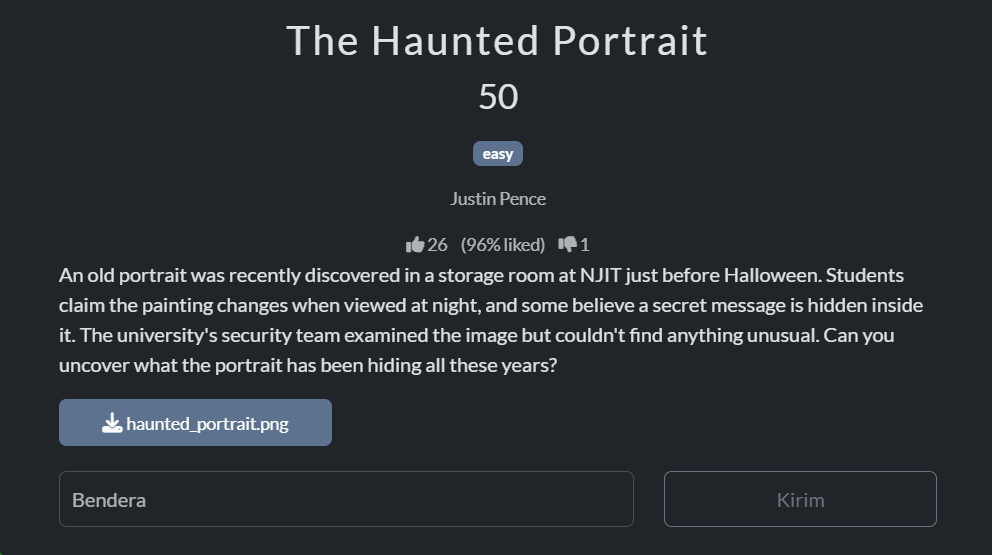

Deskripsi penting dari soal itu adalah `"Students claim the painting changes when viewed at night, and some believe a secret message is hidden inside it."`

Ini menandakan ada sesuatu dibalik atau dibelakang fotonya.

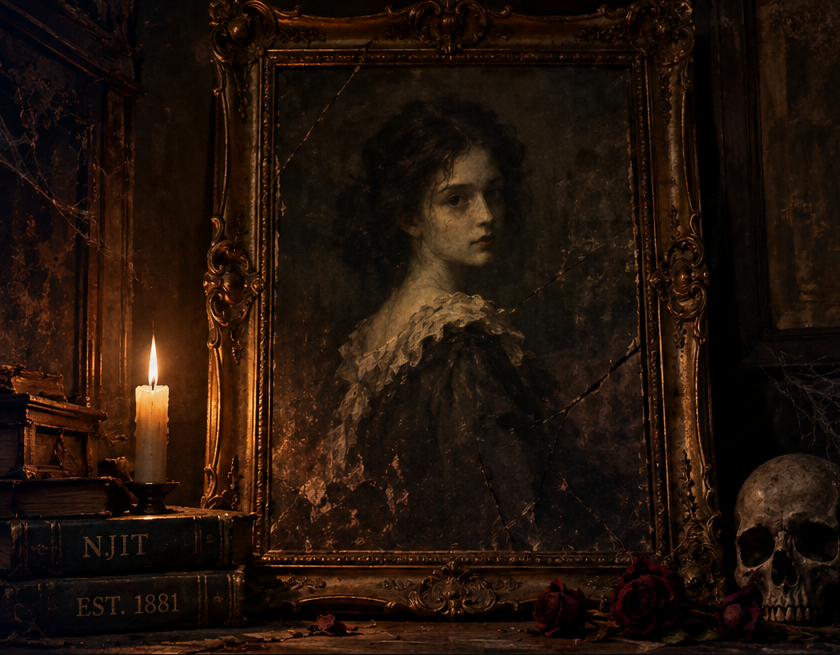
Disin tampak normal dari fotonya dan kita coba cek metadatanya langsung.

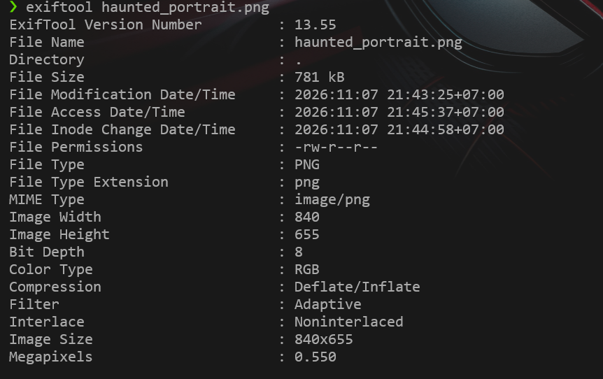

Jadi disini tidak apa-apa dan normal, Infonya itu color type : RGB, lalu PNG, dan ukurannya saja.
Disini saya coba cara lain yang kemungkinan ada temuan menarik, akan saya berikan sekaligus research saya yang saya lakukan :

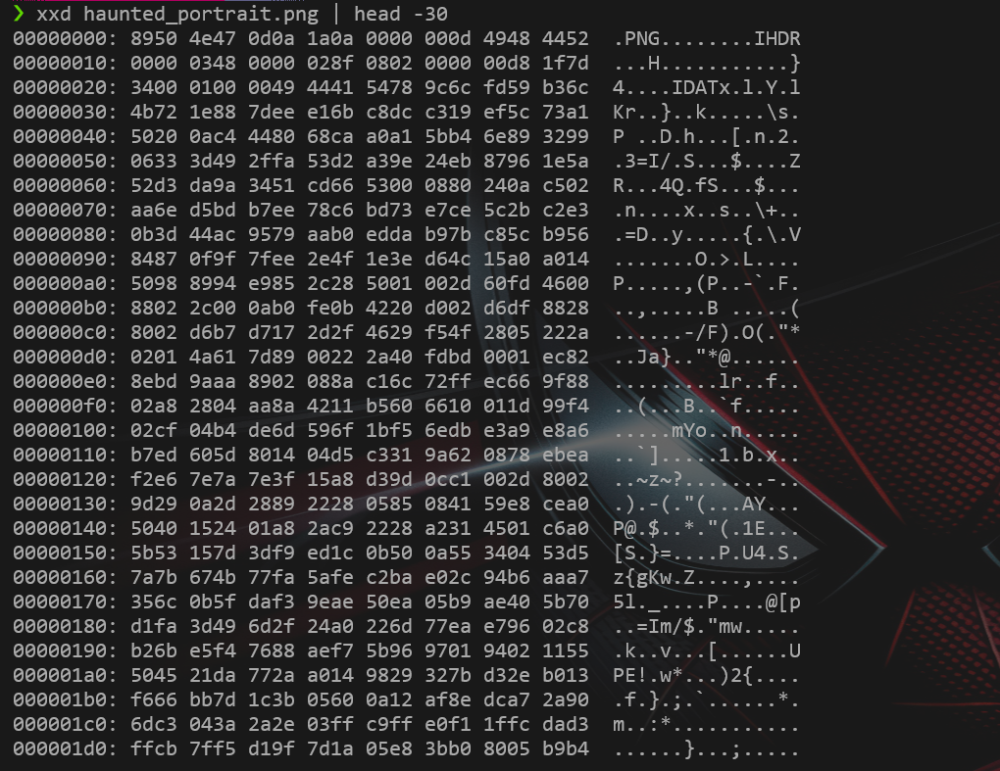

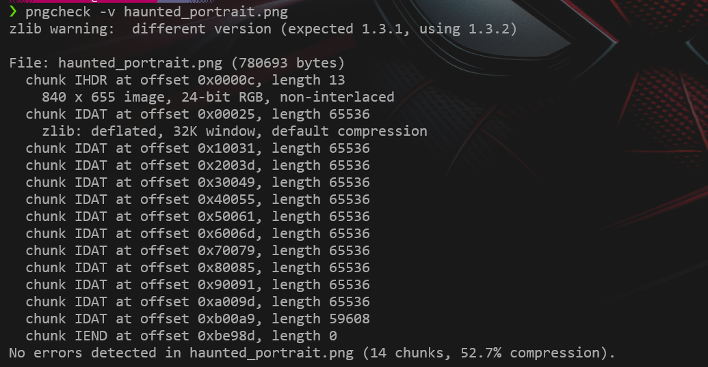

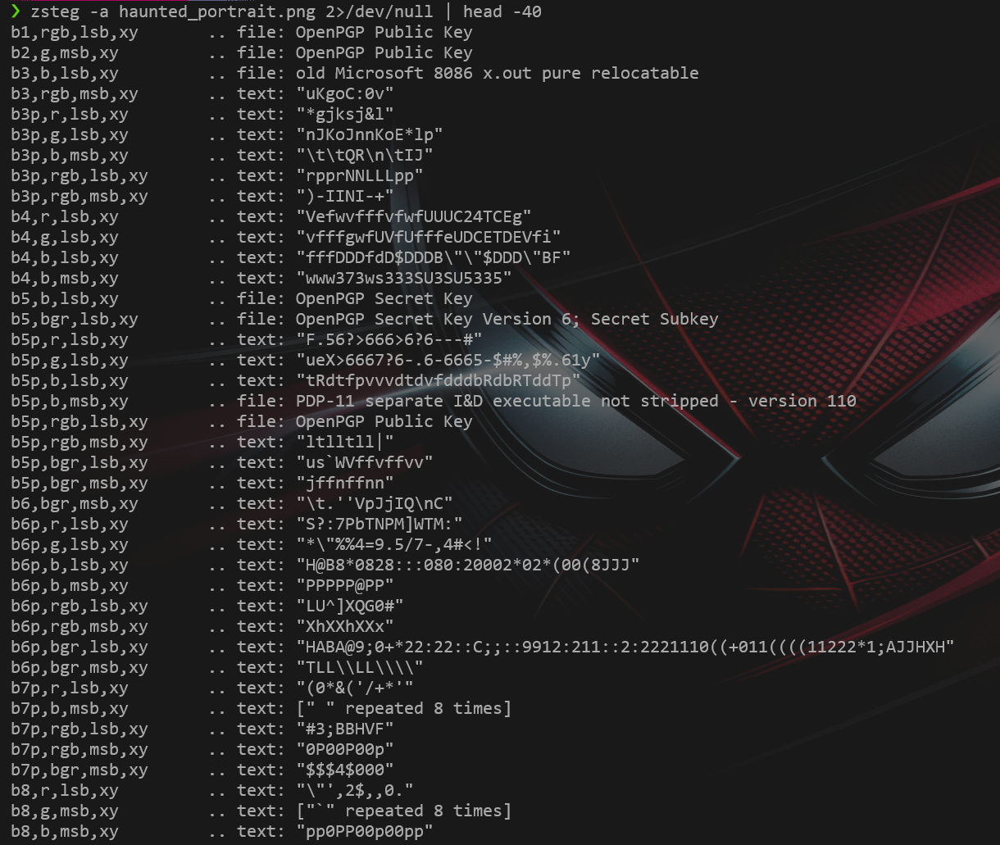

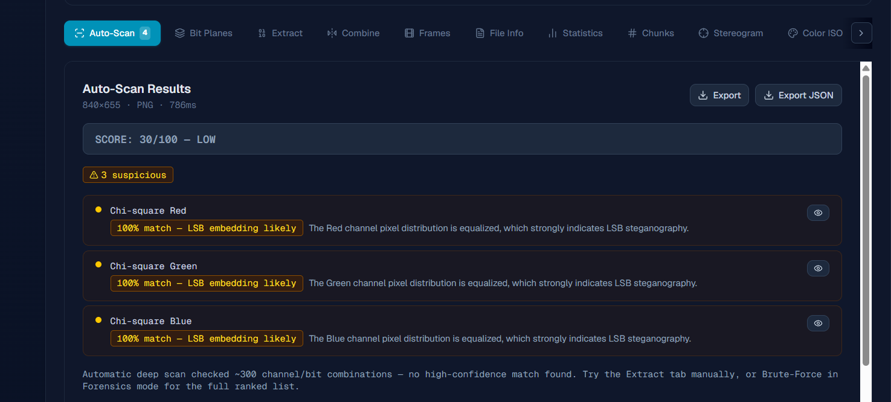

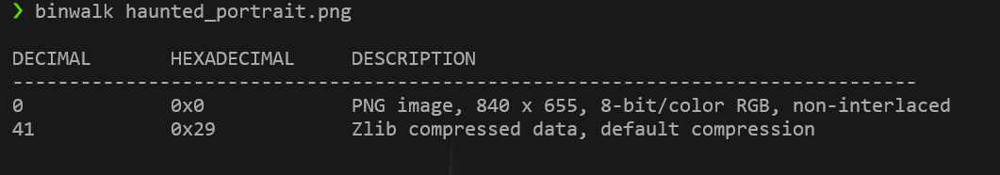

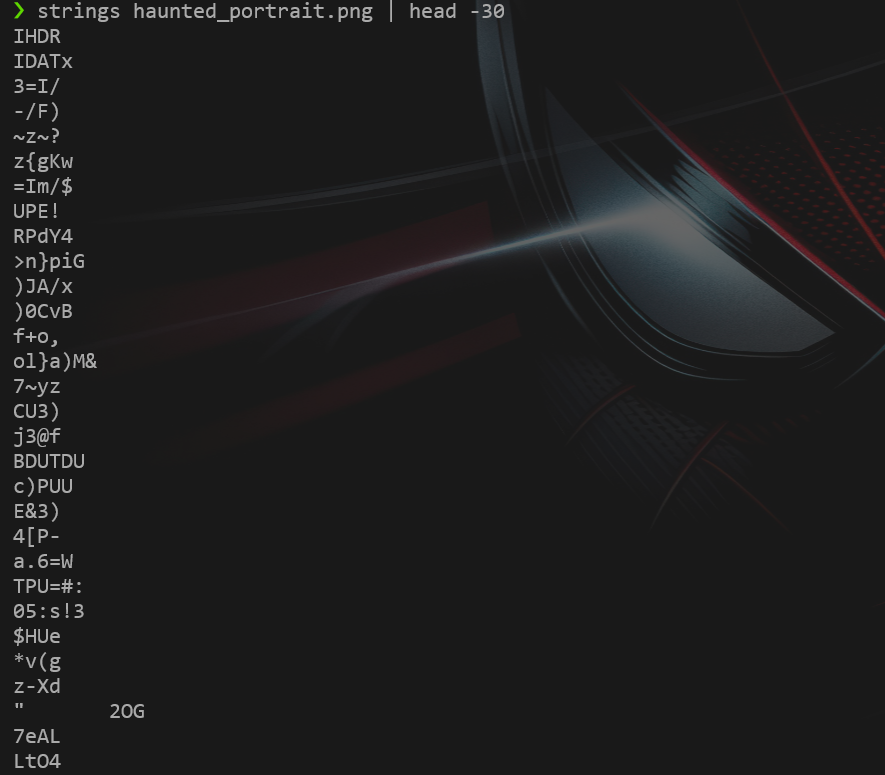

Oke, itu adalah pencarian yang saya lakukan mulai dari struktur metadata, hexadecimal bit, detail, dan scan terkait indikasi dalam foto tersebut yang ternyata memiliki LSB (Least Significant Bit). Yang kemungkinan ada bit kecil yang menyelinap menjadi sebuah "teks". Disini saya belum tahu pasti juga sih karena itu tool dari web stego.

Lalu saya mencari-cari cara untuk bisa melihat bit yang ada didalam foto tersebut (tentunya dengan AI) dan ternyata ada caranya yaitu cari bit plane nya dari struktur RGB. Di metadata sebelumnya sudah disinggung kan dia color typenya RGB. Kita coba cari terkait bit plane nya (saya cari toolnya di website karena WSL memiliki banyak kekurangan terkait Visualisasinya dan saya kurang tahu toolsnya apa yang harus diunduh, Maaf kalau semisal di WSL memang bisa karena saya tidak tahu).

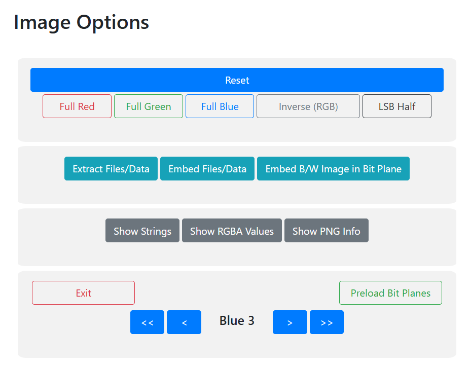

Disini aku menemukan tools stego yang bisa membaca RGB dan mencari bit plane nya satu-persatu.
Aku mulai mencari satu-satu dari merah, hijau, sampai biru. Dan saat di biru aku menemukan sesuatu tidak biasa dan jelas itu hasilnya.

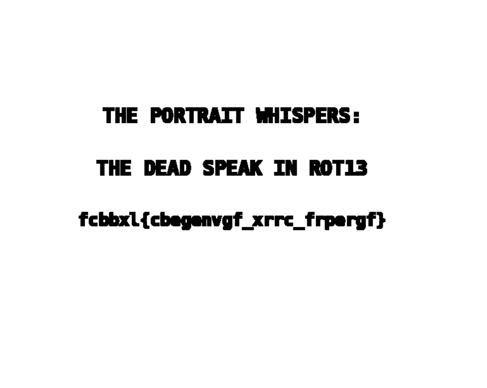

Disini hasilnya masih harus kita ekstrak dari rot13 (Disini saya menggunakan cyberchef). Kalau mencari proses ini otomasi dengan AI itu cukup gak bagus hasilnya (mungkin yaaa) karena tulisan ini seharusnya gak begitu bisa dibaca AI ya karena dibaca manusia seperti saya itupun agak bingung itu e atau a. Jadi seharusnya AI agak sulit, tapi hasilnya gak beda jauh mungkin. 

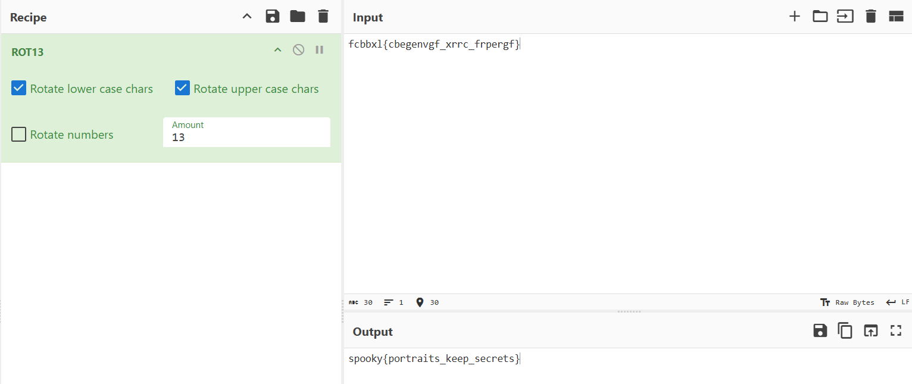

Dan ketemulah flag nya dari ekstrak ROT13 tersebut.

## Sekian Terimakasih
Maaf apabila ada salah sebut, salah perkiraan, atau salah istilah karena saya masih belajar tentunya. Dan CTF ini menjadi pembelajaran besar bagi saya karena proses saya sudah cukup jauh bagi saya.